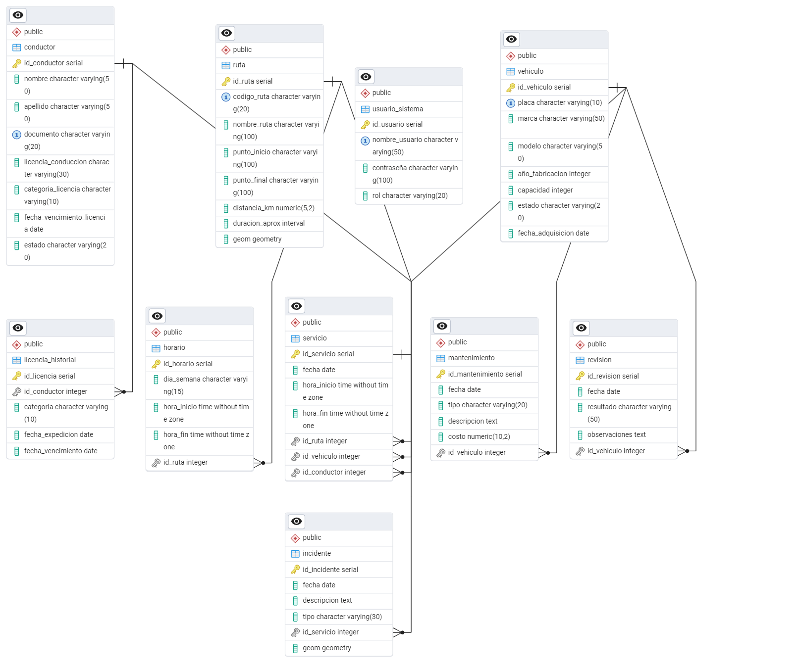

# Modelo relacional

Base de datos: `transporte_cartago_sig` (PostgreSQL 16 + PostGIS 3.5).
Origen: copia de la base "ProyectoFinal" del curso de Bases de Datos (gestión de servicios de transporte y parque automotor en Cartago, Valle). Sobre la copia se agregó el componente espacial.

Sistema de referencia de las geometrías: **EPSG:4326** (WGS 84, longitud/latitud en grados).

## Diagrama entidad-relación

## Tablas

| Tabla | Clave primaria | Claves foráneas | Geometría | Descripción |
|---|---|---|---|---|
| `ruta` | `id_ruta` | — | `geom` LineString, 4326 | Rutas urbanas (código, nombre, inicio, fin, distancia registrada, duración) |
| `incidente` | `id_incidente` | `id_servicio` → `servicio` | `geom` Point, 4326 | Incidentes ocurridos durante un servicio (fecha, descripción, tipo) |
| `servicio` | `id_servicio` | `id_ruta` → `ruta`; `id_vehiculo` → `vehiculo`; `id_conductor` → `conductor` | — | Viaje realizado: fecha, horas, ruta, vehículo y conductor |
| `horario` | `id_horario` | `id_ruta` → `ruta` | — | Horario de operación por día de la semana |
| `vehiculo` | `id_vehiculo` | — | — | Parque automotor (placa, marca, modelo, año, capacidad, estado) |
| `conductor` | `id_conductor` | — | — | Conductores (documento, licencia, categoría, vencimiento, estado) |
| `licencia_historial` | `id_licencia` | `id_conductor` → `conductor` | — | Histórico de licencias de cada conductor |
| `mantenimiento` | `id_mantenimiento` | `id_vehiculo` → `vehiculo` | — | Mantenimientos de los vehículos (tipo, costo) |
| `revision` | `id_revision` | `id_vehiculo` → `vehiculo` | — | Revisiones de los vehículos (resultado, observaciones) |
| `usuario_sistema` | `id_usuario` | — | — | Usuarios del sistema original (no se usa en el visor) |

Total: **10 tablas de negocio**, **8 claves foráneas**, **2 tablas con geometría** (`ruta` y `incidente`).
Las tablas `spatial_ref_sys`, `geometry_columns` y `geography_columns` las crea PostGIS y no forman parte del modelo.

## Relaciones

| Relación | Cardinalidad |
|---|---|
| `ruta` 1 — N `servicio` | una ruta tiene muchos servicios |
| `vehiculo` 1 — N `servicio` | un vehículo hace muchos servicios |
| `conductor` 1 — N `servicio` | un conductor hace muchos servicios |
| `servicio` 1 — N `incidente` | un servicio puede tener varios incidentes |
| `ruta` 1 — N `horario` | una ruta tiene varios horarios |
| `vehiculo` 1 — N `mantenimiento` | un vehículo tiene varios mantenimientos |
| `vehiculo` 1 — N `revision` | un vehículo tiene varias revisiones |
| `conductor` 1 — N `licencia_historial` | un conductor tiene varias licencias en su historial |

## Componente espacial

| Columna | Tipo | SRID | Índice | Cómo se obtuvo |
|---|---|---|---|---|
| `ruta.geom` | `geometry(LineString, 4326)` | 4326 | `idx_ruta_geom` (GIST) | Trazado sobre calles reales desde OSRM (datos de OpenStreetMap), a partir de coordenadas de inicio y fin tomadas manualmente. Script: `scripts/cargar_rutas.py` |
| `incidente.geom` | `geometry(Point, 4326)` | 4326 | `idx_incidente_geom` (GIST) | Derivada con `ST_LineInterpolatePoint` sobre la ruta del servicio. Script: `sql/02_geometrias.sql` |

## Fuentes de los datos

- **Datos alfanuméricos** (conductores, vehículos, servicios, horarios, etc.): base propia del curso de Bases de Datos; son datos de ejemplo.
- **Coordenadas de inicio y fin de cada ruta:** tomadas manualmente de Google Maps / OpenStreetMap.
- **Trazados de las rutas:** servicio de enrutamiento OSRM público (perfil `driving`), © contribuyentes de OpenStreetMap.
- **Ubicación de los incidentes:** derivada, no medida en campo (ver limitaciones en el README).
