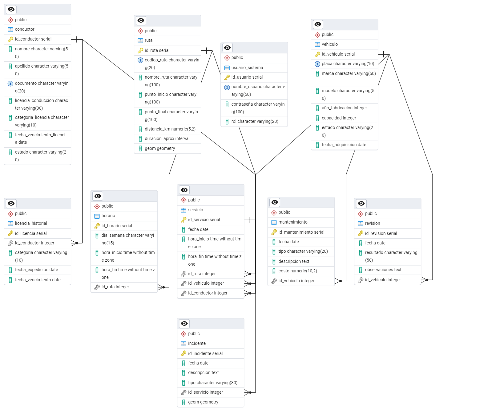

# SIG Web · Transporte urbano de Cartago (Valle)

Tarea integradora de *Programación para SIG* — Universidad del Quindío.
**Autora:** Nicole Restrepo Libreros · Ingeniería Topográfica y Geomática.
**Repositorio:** https://github.com/nicolerestrepol1404/sig_transporte_cartago

## 1. Objetivo y alcance

Visor SIG Web que muestra en un mapa las rutas de una empresa de transporte urbano de Cartago y los incidentes ocurridos en ellas, consultando una geodatabase PostgreSQL/PostGIS a través de una API.

Alcance: 5 rutas, 8 incidentes y 10 tablas relacionadas. El visor permite ver las capas, consultar los atributos de una ruta, buscar incidentes dentro de un radio alrededor de un punto y calcular un resumen por ruta. Es un proyecto académico con datos de ejemplo; no es un sistema en producción.

## 2. Fuentes de los datos

| Dato | Fuente |
|---|---|
| Tablas alfanuméricas (conductores, vehículos, servicios, horarios, etc.) | Base propia del curso de Bases de Datos ("ProyectoFinal"); datos de ejemplo |
| Coordenadas de inicio y fin de cada ruta (10 puntos) | Tomadas manualmente de Google Maps / OpenStreetMap |
| Trazado de las rutas sobre las calles | Servicio público OSRM (perfil `driving`), con datos © contribuyentes de OpenStreetMap |
| Ubicación de los incidentes | Derivada con `ST_LineInterpolatePoint` sobre la ruta de su servicio (ver limitaciones) |
| Mapas base | OpenStreetMap e imagen satelital de Esri |

## 3. Arquitectura

```
 Navegador (frontend)               API (backend)                  Base de datos
┌──────────────────────┐  HTTP   ┌────────────────────┐  psycopg  ┌─────────────────────┐
│ HTML + CSS + JS      │ ──────> │ Python + FastAPI   │ ────────> │ PostgreSQL 16       │
│ Leaflet              │ <────── │ (backend/main.py)  │ <──────── │ + PostGIS 3.5       │
│ (frontend/)          │ JSON /  │ consultas con %s   │  filas    │ (transporte_cartago │
└──────────────────────┘ GeoJSON └────────────────────┘           │  _sig)              │
                                                                  └─────────────────────┘
```

- El frontend **solo consulta la API**; no contiene datos simulados.
- La API ejecuta las consultas con parámetros (`%s`), nunca concatena entradas del usuario en el SQL.
- Las credenciales de la base se leen de un archivo `.env` que **no** se sube al repositorio.
- FastAPI también sirve el frontend, por eso todo se abre desde `http://127.0.0.1:8000`.

## 4. Estructura del repositorio

```
sig_transporte_cartago/
├── backend/
│   ├── main.py              API FastAPI
│   ├── requirements.txt     dependencias de Python
│   └── .env.example         plantilla de credenciales
├── frontend/
│   ├── index.html
│   ├── style.css
│   └── script.js            Leaflet + llamadas a la API
├── scripts/
│   └── cargar_rutas.py      carga los trazados de las rutas desde OSRM
├── sql/
│   ├── transporte_cartago_sig.sql   respaldo completo (estructura + datos + geometrías)
│   └── 02_geometrias.sql            componente espacial agregado a la base original
├── Evidencias/
│   ├── modelo_relacional.md         modelo relacional documentado
│   ├── diagrama_er.png              diagrama entidad-relación
│   └── Evidencias_repositorio.pdf   capturas y consultas verificadas
└── README.md
```

## 5. Modelo relacional

10 tablas y 8 claves foráneas, con geometría en `ruta` (LineString, EPSG:4326) e `incidente` (Point, EPSG:4326). La descripción completa de tablas, claves, relaciones y fuentes está en [`Evidencias/modelo_relacional.md`](Evidencias/modelo_relacional.md).



## 6. Requisitos e instalación

- Python 3.12
- PostgreSQL 16 con PostGIS 3.5 (se instala con *Stack Builder* o el instalador de PostGIS)
- Un navegador actualizado y conexión a internet (para los mapas base)

**1. Clonar o descargar el repositorio** y abrir una terminal (cmd) en la carpeta del proyecto.

**2. Instalar las dependencias de Python:**

```
cd backend
pip install -r requirements.txt
```

**3. Crear la base de datos y restaurar el respaldo.** Si `psql` no está en el PATH, usar la ruta completa (por ejemplo `C:\Program Files\PostgreSQL\16\bin\psql.exe`):

```
createdb -h localhost -p 5432 -U postgres transporte_cartago_sig
psql -h localhost -p 5432 -U postgres -d transporte_cartago_sig -f sql/transporte_cartago_sig.sql
```

El respaldo ya incluye `CREATE EXTENSION postgis`, la estructura, los datos y las geometrías. Para comprobarlo:

```
psql -h localhost -p 5432 -U postgres -d transporte_cartago_sig -c "SELECT (SELECT count(*) FROM ruta WHERE geom IS NOT NULL) AS rutas, (SELECT count(*) FROM incidente WHERE geom IS NOT NULL) AS incidentes;"
```

Debe devolver `rutas = 5` e `incidentes = 8`.

**4. Configurar las credenciales.** Copiar `backend/.env.example` como `backend/.env` y completar los valores:

```
DB_HOST=localhost
DB_PORT=5432
DB_NAME=transporte_cartago_sig
DB_USER=postgres
DB_PASSWORD=<tu contraseña de PostgreSQL>
```

El archivo `.env` está en `.gitignore` y no debe subirse nunca.

### Alternativa: construir la geometría desde cero

Si se parte de la base original sin geometrías: ejecutar `sql/02_geometrias.sql` (crea columnas e índices), luego `python scripts/cargar_rutas.py` (pide la contraseña por teclado y descarga los trazados de OSRM; requiere internet) y volver a ejecutar la sentencia `UPDATE` de `02_geometrias.sql` para ubicar los incidentes.

## 7. Ejecución

```
cd backend
python -m uvicorn main:app --reload
```

- Visor: http://127.0.0.1:8000
- Documentación interactiva de la API (Swagger): http://127.0.0.1:8000/docs

La ventana de la terminal debe permanecer abierta mientras se usa el visor.

## 8. Funcionalidades y endpoints

| Código | Funcionalidad | Endpoint | Función PostGIS |
|---|---|---|---|
| — | Estado de la conexión | `GET /api/salud` | `PostGIS_Version()` |
| F1 | Visualizar rutas (GeoJSON LineString) | `GET /api/rutas` | `ST_AsGeoJSON` |
| F1 | Visualizar incidentes, con filtro opcional por tipo | `GET /api/incidentes?tipo=` | `ST_AsGeoJSON` |
| F1 | Tipos de incidente para el filtro | `GET /api/incidentes/tipos` | — |
| F2 | Atributos de una ruta: datos, horarios, últimos 5 servicios, número de incidentes | `GET /api/rutas/{id_ruta}` | — (consultas relacionales con JOIN) |
| F3 | Incidentes dentro de un radio de un punto y ruta más cercana | `GET /api/incidentes/cercanos?lat=&lng=&radio=` | `ST_DWithin`, `ST_Distance`, `ST_MakePoint`, `ST_SetSRID` |
| F4 | Resumen por ruta: km registrados vs. medidos e incidentes por km | `GET /api/resumen-rutas` | `ST_Length` |

Validaciones de F3: `lat` entre -90 y 90, `lng` entre -180 y 180, `radio` entre 50 y 5000 m. Ante un error de base de datos la API responde HTTP 500 con un mensaje genérico, sin exponer detalles internos.

### Justificación de F3 (tipo de geometría, SRC y unidades)

- **Tipo de geometría:** los incidentes son puntos (`Point`) y se busca cuáles caen dentro de un círculo alrededor de un punto elegido, por lo que `ST_DWithin` (distancia máxima entre geometrías) es la función adecuada. Además, `ST_Distance` entrega la distancia de cada incidente, y la ruta más cercana se obtiene ordenando por distancia a las líneas.
- **SRC:** las geometrías están en EPSG:4326, cuyas unidades son **grados**. Usar `ST_DWithin` directamente sobre ellas interpretaría el radio en grados, lo cual no tiene sentido para metros.
- **Unidades:** por eso las geometrías se convierten a `geography` (`geom::geography`), y `ST_DWithin` y `ST_Distance` trabajan en **metros** sobre el elipsoide. Así el radio que escribe el usuario (50–5000 m) y las distancias devueltas están en metros.
- **Rendimiento:** los índices GIST (`idx_incidente_geom`, `idx_ruta_geom`) aceleran las consultas espaciales.

## 9. Demostración de una operación completa (F3)

1. **Interacción del usuario:** en el panel, el usuario deja el radio en 500 m, pulsa "Elegir punto en el mapa" y hace clic en el punto `lat 4.7556, lng -75.9282`.
2. **Endpoint:** el frontend (`script.js`) envía `GET /api/incidentes/cercanos?lat=4.7556&lng=-75.9282&radio=500`.
3. **Consulta SQL/PostGIS** ejecutada por el backend con parámetros:

```sql
SELECT i.id_incidente, i.fecha, i.descripcion, i.tipo, r.codigo_ruta,
       round(ST_Distance(i.geom::geography, p.g)::numeric, 1)::float AS distancia_m,
       ST_AsGeoJSON(i.geom) AS geometria
FROM incidente i
JOIN servicio s ON s.id_servicio = i.id_servicio
JOIN ruta r ON r.id_ruta = s.id_ruta
CROSS JOIN (SELECT ST_SetSRID(ST_MakePoint(%s, %s), 4326)::geography AS g) p
WHERE i.geom IS NOT NULL AND ST_DWithin(i.geom::geography, p.g, %s)
ORDER BY distancia_m;
```

   con los parámetros `(-75.9282, 4.7556, 500)`.
4. **Respuesta GeoJSON/JSON:** la API convierte las filas en una `FeatureCollection` y responde `{"radio_m": 500, "incidentes": {...}, "ruta_mas_cercana": {...}}`. Para este punto devuelve 1 incidente (id 1, tipo *Retraso*, ruta R001, a 1.9 m) y la ruta más cercana R001 a 1.1 m.
5. **Representación en Leaflet:** el visor dibuja un círculo de 500 m, un marcador en el punto, un anillo rojo sobre cada incidente encontrado y muestra en el panel la tabla de resultados y la ruta más cercana.

## 10. Verificación técnica

Se contrastaron los resultados del visor con consultas SQL ejecutadas directamente en PostgreSQL (pgAdmin):

- **F3:** la misma consulta con `ST_MakePoint(-75.9282, 4.7556)` y radio 500 devuelve 1 fila (id_incidente 1, *Retraso*, distancia ≈ 1.9 m), igual que el visor y que la respuesta de `/docs`.
- **F4:** la consulta con `ST_Length(geom::geography)` y `count(incidente)` agrupada por ruta coincide con la tabla "Resumen por ruta" del visor.
- **Reproducibilidad:** el respaldo se restauró en una base nueva y devolvió 5 rutas y 8 incidentes con geometría.

Las capturas del visor, de `/docs`, de la respuesta JSON y de las consultas en pgAdmin están en [`Evidencias/Evidencias_repositorio.pdf`](Evidencias/Evidencias_repositorio.pdf).

## 11. Limitaciones

- **Ubicación de los incidentes aproximada:** la base original no registraba dónde ocurrió cada incidente. Sus posiciones se derivaron colocándolos sobre la ruta de su servicio, en una fracción calculada a partir del `id`. **No son mediciones de campo.** Las consultas espaciales son técnicamente correctas, pero sus resultados dependen de esta ubicación derivada.
- **Trazados de las rutas:** se generaron con el perfil `driving` de OSRM entre solo dos puntos (inicio y fin), sin paradas intermedias; pueden no coincidir con el recorrido real de los buses.
- **Distancias registradas vs. medidas:** la columna `distancia_km` proviene de datos de ejemplo de la clase de Bases de Datos y difiere de la longitud medida sobre el trazado (por ejemplo, R001: 8.5 km registrados frente a 4.51 km medidos). Por eso F4 muestra ambas.
- **Datos de ejemplo:** conductores, vehículos y servicios no son datos reales de una empresa. Las contraseñas de `usuario_sistema` fueron reemplazadas por valores de ejemplo.
- **Configuración de desarrollo:** el CORS está abierto (`*`) y el servidor se ejecuta en modo `--reload`; para producción habría que restringirlos.

## 12. Atribuciones

- Datos de mapa y trazados: © contribuyentes de [OpenStreetMap](https://www.openstreetmap.org/copyright), mediante el servicio público [OSRM](https://project-osrm.org/).
- Imagen satelital: Esri.
- Librerías: [Leaflet](https://leafletjs.com/), [FastAPI](https://fastapi.tiangolo.com/), [psycopg](https://www.psycopg.org/), [PostGIS](https://postgis.net/).
